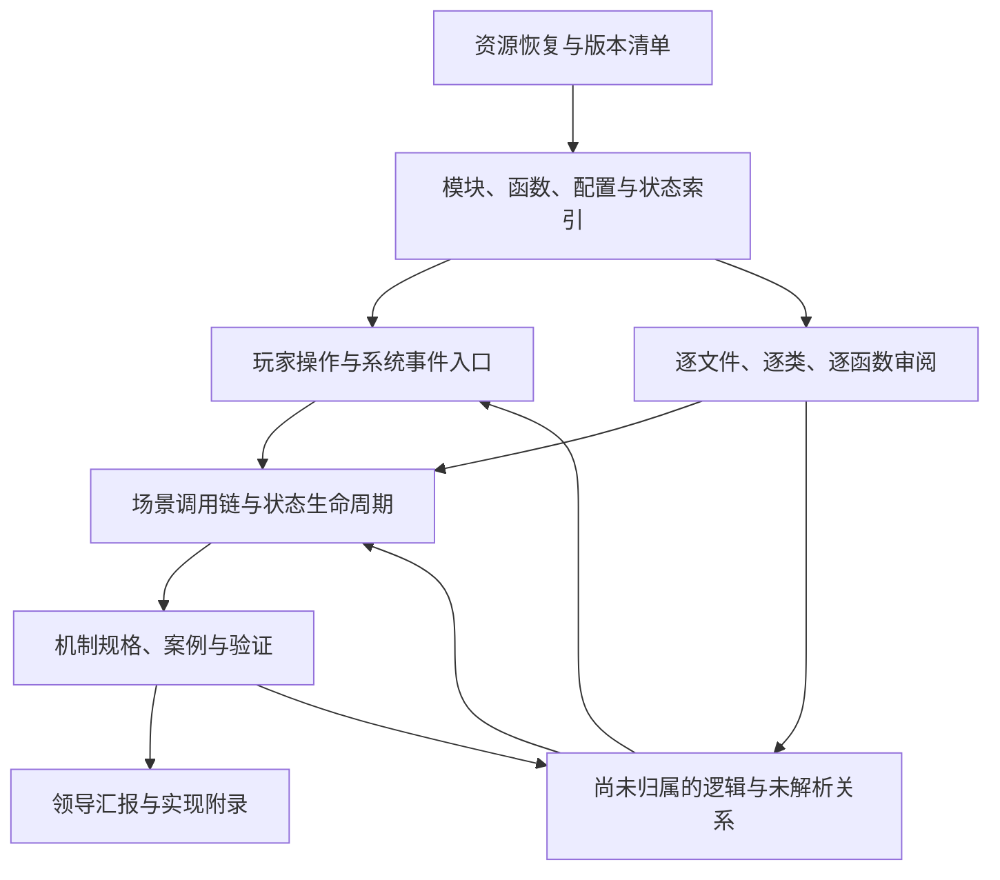

# Gossip Harbor 全量逻辑还原与汇报方案

版本：v1.0  
制定日期：2026-10-09（Asia/Shanghai）  
状态：执行方案，尚不代表各阶段已经完成。  
适用样本：当前工作区 Gossip Harbor 3.98.10；后续版本、热更新及账号配置必须分别登记。

## 1. 目标与交付标准

本项目要形成一份能够指导游戏复刻的机制规格，同时提供领导能够读懂的解释与汇报材料。

最终要求是：实现人员能够依据规格确定配置选择、执行顺序、算法、状态变化、持久化、重置和异常行为，不需要自行猜测关键规则；汇报读者能够理解玩家经历了什么、规则如何运作，以及证据和未知边界在哪里。

分析对象覆盖当前样本中发现的全部客户端代码与资源，包括核心玩法、活动、UI 交互约束、教程、生命周期、存档同步、配置装载及相关平台接口。远端资源和服务端决定的行为作为明确的外部依赖登记。

“完整”必须绑定版本与资源快照。当前客户端覆盖完整，不等于已经取得所有未来活动、所有账号分组配置或服务端实现。已确认的未知不能被隐去，也不能被猜测填满。

## 2. 已达成的方法共识

1. 先识别和恢复全部已取得资源，核验可用性，防止容器漏解。
2. 建立分类索引，识别系统、模块、配置和资源归属。
3. 从玩家操作及系统事件出发，追踪有明确上下文的运行过程。
4. 逐文件、逐类、逐函数审阅，识别每段实际逻辑，发现新机制后扩展分类。
5. 跨模块整合调用、事件、状态和配置，解释完整行为及生命周期。
6. 用证据、案例和运行观察验证，再形成汇报与实现规格。

固定检查问题只用于复核，不能限定分析范围。随机机制只是一个例子；任务范围是全部机制。

纯函数翻译不能作为分析完成的依据。代码读懂之后，还必须说明其在何种状态下被触发、造成何种结果，以及下一次执行为何可能不同。

## 3. 两条主线与闭环

### 3.1 从操作和事件向下追踪

以可理解的场景为入口，例如“点击生成器一次”“提交订单”“购买商品”“离线后重新登录”。每个场景都追踪输入条件、实际配置、分支、状态变化、后续事件与结果。

入口不仅来自玩家点击，还包括初始化、每帧或定时更新、活动切换、网络响应、应用前后台切换、存档迁移和异常恢复。

### 3.2 从代码清单向上核销

所有已识别代码单元均要有审阅记录。尚未被操作链引用的函数不能自动忽略，必须查明它属于后台入口、回调、特殊分支、工具代码、遗留代码，还是暂未找到入口的逻辑。

“未发现调用者”不足以证明代码不会执行。动态调用和事件注册未解决前，应保留为待追踪项。

### 3.3 两条主线相互验证

这张图描述工作流程，不代表已确认的游戏调用关系。

## 4. 阶段一：资源恢复与可用性审计

### 4.1 建立原始资源账本

记录 APK 与 split、Unity bundle、TextAsset、Lua 容器、配置、IL2CPP 元数据与原生库，以及已取得的远端 catalog、热更新和运行时文件。

每个资源记录来源、版本、获取时间、大小、SHA-256、父容器、处理工具与处理结果。输出文件关联回原始资源，原始证据保持不变。

### 4.2 按资源类型核验

- 容器：模块数、声明长度和实际解析长度一致；未识别内容明确登记。
- Lua：字节码版本、函数原型、嵌套函数和常量能够解析；反编译失败不等于字节码不可分析。
- 配置：字段、类型、行数和变体被保留，不能在导出时静默丢字段或将缺失值改成零。
- 原生逻辑：区分类型和签名已恢复、方法体已分析、仅找到调用入口三种情况。
- 美术与文本：能定位、关联到系统并按类型读取；不要求将所有二进制变成文本。

### 4.3 确定实际生效版本

追踪装载器及覆盖规则，说明包内代码、热更新、普通配置、活动配置和账号分组配置如何选择。文件同时存在不能证明它们同时生效。

阶段出口：每个已发现资源都有处理状态；未恢复资源及原因可枚举。存在未恢复内容时，后续可推进已恢复部分，但整体不能标记为资源完整。

## 5. 阶段二：分类与关联索引

### 5.1 分类可随发现扩展

初始分类包含棋盘与物品、生成与合成、能量与冷却、订单与奖励、经济与商店、剧情与进度、活动、教程、UI 与交互、存档与同步、装载与平台服务。

分类用于组织信息；任何无法解释的新逻辑都可以新增分类。每个文件有主要归属，也可以关联多个系统。

### 5.2 建立逻辑关联图

节点包括资源、模块、类、函数、配置、状态字段、事件和存档字段。关系至少包括：

- 直接调用、方法调用、继承、工厂或注册表选择。
- 事件注册与派发、回调传递、计时器注册及取消。
- 配置装载、覆盖、筛选及字段读取。
- 状态初始化、读取、写入、清理、重置。
- 存档写入、恢复、迁移，以及网络数据的输入和输出。

每条关系附证据位置与确定性：已确定、候选关联、未解析。动态调用不能被强行绑定到一个目标。

字段按所属对象和作用域区分。同名字段不能直接合并；对象别名导致的潜在关联保留待确认标记。

### 5.3 工具选择和验证

优先利用现有提取与解密脚本，增加可重复运行的字节码解析、索引和覆盖检查工具。可评估兼容的 Lua 5.3 反编译器，以及 Il2CppDumper、Ghidra 等工具。

采用反编译结果前，先用实际样本检查分支、循环、闭包、方法调用和多返回值是否正确。字节码和原始资源保留为证据，反编译文本只是辅助阅读材料。

运行时追踪用于确认静态分析中的歧义，包括动态调用目标、实际配置、事件顺序和状态变化。记录追踪环境与插桩方式；被观察过的路径不能代表所有路径都已覆盖。

### 5.4 内置测试框架索引

将包内 `Test.*` / `test_debug` 代码、测试窗口、命令表、快捷按钮与自定义配置作为阶段二的专门索引对象。需要建立“面板/按钮或命令 → 配置选择 → UI 回调 → TestModel 或玩法模型 → 状态/网络/存档副作用”的证据链，并登记 `ProjectConfig.IS_TEST_MODE`、本地偏好开关、账号远端自定义配置等启用条件。

每个测试入口标注静态副作用线索和证据位置；只有调用链和状态写入核实后才可标为确定。测试工具是发现和验证机制的工具，不代表正式玩家路径。运行验证优先使用隔离账号或可恢复环境；涉及删除数据、跳关、经济资源、支付、服务器配置或账号状态的命令先完成副作用审阅。

阶段二验收至少提供：测试模块全量清单；面板、标签、按钮和命令配置间的索引；可静态识别的回调和未解析目标；本地/服务端启用条件；高风险或外部副作用候选清单；运行时哪些入口实际可用的验证记录。仅发现测试代码或只列出按钮名称不算完成。

阶段出口：所有已解析代码进入索引；工具支持边界、解析失败和动态关系缺口明确列出。

## 6. 阶段三：入口场景与逐函数审阅

### 6.1 建立入口目录

| 入口类别 | 初始场景示例 |
| --- | --- |
| 棋盘操作 | 点击生成器、拖动合成、移动、出售、撤销、放入或取出仓库 |
| 资源操作 | 消耗或恢复能量、购买、领取奖励、加速冷却 |
| 订单与进度 | 提交订单、完成任务、升级、进入下一剧情阶段 |
| 活动与教程 | 活动进入或结束、领取阶段奖励、教程推进或中断 |
| 生命周期 | 首次启动、登录、重登、断线恢复、离线返回、前后台切换 |
| 自动与外部 | 计时到期、周期更新、远端配置更新、支付或广告回调 |

以上只是种子场景。审阅发现新入口时持续追加，以实际代码和资源为依据。

### 6.2 以明确状态追踪一次操作

每条链说明：进入时的玩家与棋盘状态、触发入口、条件和分支、配置选择、算法、资源扣除和产出、状态更新、事件及异步后续、保存、失败或中断结果。

同一操作在不同等级、活动、物品类型或异常状态下可能走不同链路。应共享公共段并解释变体条件，不能只记录一次成功路径。

异步分支要追到回调、取消、超时或后续入口。不能以函数返回作为整条行为完成的标志。

### 6.3 全量代码审阅

每个函数记录稳定标识、版本、文件位置或字节码偏移、所属类或原型、触发来源、行为解释、关键分支、调用关系、状态副作用、配置依赖、机制归属及未解决问题。

Lua 匿名函数、嵌套函数、闭包和动态绑定的方法均进入清单。无原始函数名时，用模块与原型路径定位，不能只靠反编译行号。

纯展示或通用辅助函数可以简述，但仍需核销；涉及交互门槛、资源、时间、状态或算法的函数必须深入说明。分支内逻辑不能被一句功能概述替代。

重复实现可引用已验证的公共解释，但需核对语义及差异。历史或疑似不可达代码登记依据，不能悄悄移出统计分母。

### 6.4 单条操作链的完成条件

- 触发入口和适用状态明确。
- 关键调用、事件与回调已追踪，未解析目标有具体记录。
- 输入、配置、分支及输出能够解释。
- 相关状态的初始化、修改、保存、恢复和重置已关联。
- 正常、边界、失败和特殊路径已说明，或明确标出证据缺口。
- 可以据此推演具体案例；关键步骤不存在未标注的猜测。

### 6.5 当前阶段三主线状态（工作基准）

第三阶段当前以“玩家操作为抓手，逐入口追踪到同步/持久化边界，并由逐文件逐函数审阅反向核销覆盖”为唯一主线。当前优先入口是棋盘中的母体点击、棋子拖拽/合成和订单提交；它们不是阶段三的全部范围，而是第一批用于建立可复刻级操作链的场景。

每条操作链必须同时交付：人类可读的顶层流程、中层判断顺序和子机制、底层算法/公式/具体配置/状态字段/事件/网络副作用，以及 source-confirmed、runtime-confirmed、runtime-pending、unavailable 证据标记。随机机制必须明确随机范围、候选池变化、是否放回、权重修正顺序和重置时机；不能只写“存在随机判定”。

在覆盖审计、场景回放、原版与复刻版逐字段差分、人工审阅四类证据未同时通过前，阶段三不得标记为完成，也不得宣称已经能够完整复刻或不存在遗漏。外观、导航和汇报页面的调整不得改变本工作文档中的目标、范围、证据分级和验收门槛。

### 6.6 独立清单与双向核销（2026-10-12 补充）

覆盖分母必须来自版本资源、字节码原型、代码和配置，不能来自现有网页目录或人工挑选的核心模块。先从操作追调用与事件，再从全量代码和配置反查操作归属，两条路线发现的差集均须处理。

核销的最小对象是函数内部的逻辑单元：条件分支、提前返回、循环、配置读取、状态变更、事件及异步移交。每个单元记录稳定标识、快照哈希、原型/源码位置、触发上下文、四层文档具体段落、验证案例、证据和审阅状态。出现函数名、配置全文展示、自动生成调用图均不能自动标记为已解释。

调用范围包含同步函数、继承与动态分派、匿名回调、事件订阅、持久化以及影响下一次点击的初始化、计时更新、配置重载和活动切换。公共服务或事件派发不是天然停止边界；必须说明移交对象、读写状态、后续处理和追踪位置。无法解析的目标列入缺口，不能当作无调用。

配置核销同时执行两个方向：从装载器及读取字段核对来源、默认值、缺失行为和选择优先级；从全部配置文件、分组、记录与字段反查消费者、适用对象和解释。按等价类组织案例，但全量记录仍须核对归属。重复配置可共享说明，需保留原始来源及去重依据；未用字段或未生效变体需有证据，不能静默排除。

代表案例用于理解，不证明全量覆盖。必须专门验证活动优先级、资格重叠、等级交界、配置重载、池重置、能量档与次数扣减、时间边界及存档恢复等交互。不能仅以普通成功案例、平均频率或两两组合覆盖率放行。

### 6.7 机制说明中的因果区分

各层文档必须区分：资格判定、候选选择、奖励分类、效果表现、后续奖励与状态更新。描述一个机制时明确它是否新增抽样、改变机会池、改变物品池、增加产物或只是选择展示。外部活动造成的变化必须标出独立触发条件，不能归因到一个显示名称。

例如当前快照中 Super Lucky：先从 lucky_items 选择物品，再在没有连续自定义类型时查询 super_items 成员资格，以此设置 SuperLucky / FreeSuperLucky。分类本身没有额外随机数、没有独立 Super 奖池、没有额外扣减机会池或多生成一件奖励；已找到的差异包括特效、音效和提示。GeneratorBoost 的额外 Lucky 是另一个带 Buff 与空位条件的后续分支，普通与 Super Lucky 都可能进入，不能称为 Super 独有奖励。仍须核销所有消费者后，才能作全局结论。

### 6.8 第三阶段文档生产工作流（2026-10-12）

本节规定从阶段二索引到四层文档的生产顺序，落实6.6的覆盖方法、9.4的G1–G7门禁和9.8的层级要求。它是工作流程，不是领导网站内容，也不代表各环节已经完成。母体点击提供可复用的组织方式、案例与配表样式，但当前仍未通过全量验收；不能把现有页面当作完整范围的标准答案。

总体顺序：**输入核验 → 独立范围清单 → 执行骨架预审 → 逐单元分析 → 底层文档与全量配表 → 行为校验 → 四层上层总结 → 目录组织与命名专项 → 演示案例专项（主例＋机制触发矩阵） → 素材与网站检查 → 独立总验收。**

用户提出的“先清单、再底层、再上层、最后案例”作为主体。额外增加执行骨架预审，防止底层已经写完才发现目录按主题而非执行顺序组织；增加独立行为校验，防止文字详细却算法错误；增加变更回退规则，防止后续修改悄悄破坏已验收内容。

#### 6.8.1 工作批次与执行原则

一个批次优先处理“一个操作内的一个完整子机制”，但追踪边界由真实行为决定，不由文件数量或页面数量决定。例如分析一次性母体落点，要同时追候选构造、坐标选择、占位规则、无候选返回及相关状态变化，不能停在FindRandomPosition方法名。分析Lucky物品选择，要追资格、候选修正、抽取、分类及相关状态保存，不得把跨文件依赖排除。

每批按以下环节依次提交证据，通过当前环节的专项验收后，再加工下一环节。允许先写草稿和探索后续内容，但不得提前标记通过。操作最终验收仍覆盖所有批次之间的组合、共享状态和执行顺序，不能把各批通过简单相加成整体通过。

每次开始只确认本环节的输入、要求与出口；内容、结构、案例、视觉分别审核。分析发现新逻辑时必须扩展清单，不能为了守住已排好的目录而忽略它。工作记录与领导说明分开保存，已有用户打磨的案例、配表和正文修改采用局部更新，不以整站生成覆盖。

#### 6.8.2 环节0：核验输入与保护现有内容

**输入：**安装包及恢复资源快照、阶段二索引、解析失败清单、当前文档、用户已修改的内容。

**方法与要求：**确定版本、资源与代码哈希、工具版本及解析范围；核对可执行资源、原型、匿名函数、配置变体是否都在索引中。为现有页面和用户打磨区块保存修改前快照，区分源码事实、历史结论与演示假设。阶段二的未解析项保留为待办，不能当作无逻辑。

**产物：**批次输入清单、快照标识、受保护内容清单、资源/解析缺口与影响范围。

**出口：**分析对象可以定位并复查；没有来源不明或被静默排除的输入。影响本批的未恢复代码阻断其规格放行，可先分析其它有完整输入的批次。此处不检查文案、案例或页面美观。

#### 6.8.3 环节1：建立独立范围与验收清单

**输入：**环节0快照、阶段二的入口、函数、调用、事件、状态、配置索引。

**方法与要求：**先从玩家操作向下追踪，再从全量代码和配置反查归属。核销单位落实到条件、提前返回、循环、调用、读表、写状态、通知、回调与移交；匿名闭包、动态绑定、父类行为不能遗漏。当前点击依赖的初始化、计时、恢复、配置切换也纳入生命周期清单，并标明它们发生于点击前、点击中还是后续入口，不能伪装成点击中的阶段。

清单至少记录稳定ID、来源与哈希、触发条件、前驱/后继、读写状态、配置依赖、待解析关系、解释/测试/审核状态。它是持续扩展的证据账本，不是限制分析内容的固定填表模板。阶段二工具不能解析的关系必须人工追踪、补充工具或登记缺口。

**产物：**操作范围清单、调用与事件闭包、状态生命周期清单、配置文件/记录/字段清单、双向反查差集。

**出口：**所有已发现对象有归属或明确问题记录；清单分母独立于网站；每个未解析目标有影响与下一步办法。存在缺口时可以开始有证据部分的分析，但不得声称范围已经闭合。最终范围闭合要求影响行为的未归属及未解析项为零。

#### 6.8.4 环节2：执行骨架与四层目录预审

**输入：**环节1清单、入口及实际调用位置。

**方法与要求：**先写不含大量变量和配表的执行骨架：什么条件进入、先检查什么、失败是否返回、分支是否互斥、成功后进入哪里、何时保存/通知、异步何时继续。按真实调用位置给步骤标识，标出循环、重入及活动插入位置。调用图用来找关联，执行骨架用来表达先后；不能把调用图的排列当作执行顺序。

据此预排四层：玩家操作 → 实际执行阶段 → 阶段内判断/分支 → 原始算法与配置。所有目录节点都有自己的说明页；父页讲本层整体顺序和意义，子页解释该步骤内部。此时只做结构草稿，底层分析发现差异必须修订，不能提前冻结。

**产物：**带来源位置的执行骨架、分支/返回图、四层目录草案、清单到拟定节点的映射。

**出口：**逐条比对入口流程与目录，顺序、互斥、提前返回、通知位置无冲突；不存在“事件与后续影响”“产出改写与安全边界”等独立分类子树；没有把源码文件或方法清单当成层级。复杂网状行为可在本页说明分支/回流，不能为了画成直线而改写实际执行。此处不要求完整底层正文或素材。

#### 6.8.5 环节3：逐逻辑单元分析与依赖闭合

**输入：**独立清单、执行骨架、对应源码/字节码与配置。

**方法与要求：**逐函数、逐分支阅读并追到被调用实现，分别记录输入、条件、处理顺序、输出、失败、状态及副作用。对每个读写字段追初始化、作用域、存档、恢复、清除和下一次操作影响；对派发追订阅、动态消费者与再派发；对异步追回调、取消和超时。公共API名称不能代替内部算法，尚未追完的目标保持未完成。

随机要分析到候选遍历顺序、随机接口/范围、整数或浮点映射、权重与倍率的结算顺序、是否放回、池的作用域、耗尽/重置及保存。时间要分析时钟、单位、比较符号、边界与离线行为。配置要追装载、选表、覆盖优先级、缓存重载、默认与缺失行为。设计目的与源码事实分开记录。

**产物：**逐单元分析记录、参数/状态/配置规格、更新后的执行骨架与清单、证据和未知项。

**出口：**本批每个逻辑单元都有行为解释与来源；调用内部不存在以名称占位的算法；生命周期和依赖闭合，或明确阻断受影响结论。新增对象回到环节1核销，顺序变化回到环节2预审。此处追求正确完整，不同时要求领导文案和美术排版。

#### 6.8.6 环节4：编写可实现的底层文档与配表

**输入：**环节3分析规格、已有打磨页面的案例/配表规范。

**方法与要求：**按第四层节点写算法，解释变量的业务含义、来源、类型、单位和作用域；保留执行顺序、公式、比较符号、取整、候选删除、状态前后变化、失败/空值行为及源码证据。伪代码服务于说明，不能代替文字解释。不得以“调用某方法”“随机判定”“更新状态”等概括结束底层说明。

全量配表按实际选用路径展示并解释字段、记录适用对象、真实数值与差异；仅贴原表不算分析。大量同构记录可使用表格、筛选或折叠，但每条记录须可查，不能用几条例子代替全表。反查未解释字段、记录与变体；未使用项需有依据。远端值未取得时说明接口与算法，保留定量缺口，不编造默认值。

**产物：**底层页面、完整配置展示与解释、逻辑单元到具体段落/表格的映射、源码和原配置证据。

**出口：**审阅者按文档逐步推演时，不需猜候选怎么构建、数值怎么计算、何时写入/返回；清单每项有真实解释而非名称命中；全记录与字段均已核销。缺失信息逐项阻断相关实现结论。此处先验算法与配表，暂不以漂亮页面判定通过。

#### 6.8.7 环节5：校验底层行为与数值

**输入：**底层规格、源码、独立分支清单和状态/配置边界。

**方法与要求：**制定有区分性的测试：正常、失败、边界、竞争资格、优先级重叠、池耗尽/重置、时间交界、配置变体与存档恢复。按真实条件约束选择组合，不可行分支给出证据；不能只测代表成功路径或固定的两两组合。测试说明其能区分的错误解释。

可执行恢复源码时控制随机数、时间、配置与初始状态，记录调用顺序、返回值、状态、池、事件及存档。替身服务、无法执行部分及反编译不确定性单独记录。预期结果须由源码/独立推演交叉核对，不能把文档公式复制成测试再据此自证。原版回放与恢复源码测试分别登记。

**产物：**测试输入、预期/实际轨迹、差异与修复记录、分支覆盖及未验证清单。

**出口：**本批可验证规则通过，差异已解决，未验证项与证据等级明确。测试失败回环节3/4，不带错误继续润色。当前只有安装包与解包资源：可继续完成静态规格及恢复源码验证，原版事件/状态/存档差分保持unavailable，不能因此降低G7或宣称整体完成。

#### 6.8.8 环节6：自下而上形成四层可读说明

**输入：**已审核底层规格、执行骨架、分支清单与测试结论。

**方法与要求：**先写第三层解释子机制如何工作，再写第二层解释阶段内部依次判断什么，最后写第一层解释整次玩家操作。上层保留触发条件、先后、互斥、失败与可见结果，省略本层不需要的变量推导；解释规则的意义，缺乏直接证据的设计动机标明为推断。禁止机械列举子页或逐行翻译代码。

对照每条实际路径，检查父页概括是否覆盖各子页，子页是否归属于该阶段，是否把显示分类写成额外机会，是否漏掉提前返回和活动插入。例如Lucky父页要讲先处理什么资格、如何进入物品选择、何时分类/保存；SuperLucky应在抽后分类的真实位置说明，不能暗示它是新增抽奖。

**产物：**完整四层正文、父子顺序对照记录、段落映射、所有目录节点自己的页面。

**出口：**只读父页能讲清本层过程和目的，进入子页能逐步细化同一过程，第四层能实现；无上层提前堆底层细节、无上下层矛盾、无孤立分类。正文不使用内部文档跳转弥补内容或层级缺失；阅读通过左侧树，源码/原配置下载与图片证据可保留。结构审核与内容审核分别记录，四层数量合格不等于语义合格。

#### 6.8.8a 环节6A：目录组织与页面命名专项

**输入：**环节2真实执行骨架、环节6四层正文、独立逻辑清单与现有导航树。先审结构，再审名称；该环节在案例编写前独立完成，避免为标题便利改动真实流程。

**方法与要求：**

1. **先用无正文目录检查认知结构。**第一层为玩家操作；第二层为真实判断/处理阶段；第三层为该阶段内部的具体检查或机制；第四层为相应算法、配置与实现细节。逐个核对父子包含关系、兄弟节点粒度与真实执行顺序，保留互斥、提前返回及条件分支。不能因某些步骤共享主题而把不同执行位置合并；通知、改写和失败处理仍归入其实际触发步骤。
2. **名称回答“这里处理什么”。**优先用具体对象＋动作，例如“合成资格”“竞速计分”“剪刀拆分”“仓库补交”。不把“有目标”“先尝试”“再处理”“然后返回”等串成导航标题；条件和先后写在父页流程与页首说明。避免“特殊作用”“后续处理”等不能辨认对象的抽象名称；需总称时直接点明覆盖对象，例如“升级与剪刀”。
3. **短而精确，不以字数掩盖信息。**优先约4–10个汉字，必要时保留更长名称以避免歧义；不机械截断。标题不罗列保存、日志、通知等本页全部实现动作，这些在页内展开。不能把“资格检查”改成“产出成功”等扩大承诺的名称。游戏术语与对象称呼跨页面保持一致；代码标识在必要的算法/证据位置解释。
4. **逐层做摘要测试。**父页名称能概括全部子页，但不超出本页范围；子页名称能区分各自职责。同级节点用近似粒度，不混用一种奖励、整个执行链和某一条变量写入。第四层继续保留实现细节，不因精简标题删算法或配表。每目录节点仍有自己的页面。
5. **名称与组织分开改。**名称含糊但归属正确时只改名称；确有父子归属或粒度错误，才依据调用顺序调整结构。保留旧名称→新名称、旧路径→新路径、逻辑归属的映射。优先保持现有URL；同步导航、页面主标题、父页阶段名称与正文引用，避免只改左侧标签。结构变化回退环节2/6，更新清单和案例映射，不能只靠链接补洞。

**产物：**四层目录树、术语/命名对照、各节点一句话职责、结构调整理由和逻辑单元映射；审核记录留在工作资料，领导页面只展示清晰名称与必要说明。

**专项验收与出口：**

| 校验 | 方法 | 门槛 |
| --- | --- | --- |
| 目录可理解 | 隐去正文，只读一级/二级与所需三级目录 | 能说出每节点具体处理对象及动作，无只能猜测的抽象标签 |
| 父子关系 | 用各节点一句话职责与逻辑清单对照 | 子页都是父页真实组成部分，无移位或孤立主题 |
| 同级粒度 | 横向比较兄弟节点职责 | 同一层处于相近概括层次，底层细节不提前成为上层标题 |
| 顺序不失真 | 对照原执行骨架及条件/早退 | 精简名称后实际顺序、优先级、互斥和拒绝结果仍在父页明确 |
| 覆盖不减少 | 核对调整前后逻辑与配置归属差集 | 所有原条目仍有归属；改名不能删除不易命名的逻辑 |
| 展示一致 | 对照左侧目录、页面标题、父页名称与路径 | 名称一致，节点可打开，旧路径保留或有迁移处理 |

母体点击的“状态检查→空位检查→能量检查→Lucky判断→普通产出”作为表达参照，不强行套同样阶段到其它玩家操作。该专项验收通过后再做环节7案例，环节8继续验导航点击和实际显示。命名通过不提升G1–G7的源码/行为覆盖状态。

#### 6.8.9 环节7：演示案例设计、完整推演与分层改写（独立专项）

**输入：**环节1的机制/分支/配置清单、环节3–5的真实执行规则、完整四层正文及代表性玩家场景。此环节独立于正文分析、上层总结和网站排版，不以“顺手加一个主例”代替。

**方法与要求：**

1. **先建触发矩阵。**每个机制、需要理解的内部修正及不同算法模式至少有一个使其实际发生的案例。拒绝/失败机制要演示拒绝发生及其后果；成功产出机制要演示成功产出。活动关闭、开关false、配置nil、未到门槛或被前序机制抢占，只能是补充对照，不能成为唯一演示。代表场景串主流程，独立分支场景补足其无法经过的机制。
   案例使用的母体、棋子、订单、活动和状态必须能够真实进入本页机制。若贯穿案例的母体不具备该能力，必须更换为实际支持该机制的对象（例如支持开启计时的宝箱、SmartItem 母体、生鱼链或自动 Decremental 母体），不能为了保持同一个贯穿对象而虚构不可达状态。更换对象不要求所有页面共享同一母体；每个页面可以建立独立且自洽的触发场景。扫描时还要检查其它操作（合成、订单、奖励、仓库、资源和活动）的案例，不能只修母体点击。
2. **假设完整场景，不只填几个数字。**为本页真正用到的订单缺口、库存（棋盘/仓库/缓存分别列）、等级与解锁、活动/分组/开关、时间与冷却、资源与购买价格、过滤档/倍率/规则、候选池及遍历顺序、随机输入、可用落点建立输入。缺少远端配置或账号状态时，主动给合理的演示设定并算到最终结果；不得以“无配置”“不能编造”为由让案例停在中间。简洁标注演示设定，原版真实数据仍由正文配表与证据负责。
3. **互斥路径分别触发。**例如卡片例假设临时物未生成，能量气泡例再假设卡片未生成；各自具备自身成功条件。不同模式、倍率修正、满盘/冷却等关键边界单独换前提，不拼成一次真实操作。假设可以改变输入，不能改变源码算法、跳过必要资格或把不可达helper描述成实际玩家完整路径。
4. **第四层完整推演。**列输入/配置、按源码顺序逐项代入、候选及权重变化、随机判定、状态前后值、落点和完整结算结果；出现公式必须有本例数值与计算结果，出现随机必须有本例选中物，出现库存/订单修正必须给出库存/缺口及实际倍率。不得止于“调用某函数”“符合条件”“有机会生成”。
5. **第一至三层定性改写同一案例。**说明本例满足了什么场景条件、依次判断什么、为什么这样做；用“按剩余份额无放回抽取”“按权重独立抽取”等可理解描述代替实现变量和公式。结果仍具体：哪件棋子在何处出现、物品如何消耗、金币/能量/次数如何改变、等待多久、下一次必定触发还是仅获得资格。禁止把“保存状态/增加分数/生成奖励”作为完整结果。若原贯穿案例无法触发当前操作，应换用可触发对象并在案例开头说明对象及其前置能力；“主例不适用”“独立对照才触发”“食品袋不能处于该状态”等表述不能作为该页唯一案例。
6. **每页本地相关且四层一致。**页底案例只讲该层所属步骤；父页概括不能与底层数值结果矛盾。多个场景明确分开。保留用户已打磨的正文、配表和导航，仅修改需要修订的例子；原版小图按本例参与的物品选用，素材与渲染留到环节8检查。

**产物：**机制→触发场景→所用输入/配置→完整计算→玩家结果→四层页面的案例账本；逐页本地案例；正向/拒绝/互斥与关键模式的专项核销记录。工作记录不写入领导网页。

**专项验收方法与出口：**

| 校验 | 怎么检查 | 必须达到的条件 |
| --- | --- | --- |
| 触发覆盖 | 从环节1独立清单反查案例，不只数网页 | 机制及需演示的内部修正/模式均有实际触发场景；只有跳过例的数量为0 |
| 输入闭合 | 沿本例执行路径逐读取点核输入 | 所有参与的配置、库存、缺口、活动、资源、时间、随机和落点有值；未知原值已补演示值 |
| 底层闭合 | 按源码顺序手工复算，适合时用恢复源码执行 | 每次判断/抽取/修正有实际结果，完整走到保存/落盘/发奖或明确拒绝结果，无未结算占位符 |
| 上层可读 | 隐去底层后只读本页案例 | 能讲清本例先后判断、目的和具体玩家结果，无公式或变量堆砌 |
| 跨层一致 | 共享案例数据并逐段对照 | 同一场景的产物、数量、位置、资源与后续资格完全一致；互斥场景无混写 |
| 事实边界 | 对照正文证据和案例标签 | 假设不冒充原配表，不用假设创造不存在的机制；案例通过不代替逻辑/配表全量验收 |

以上任一项失败，只回到本环节修正相应场景；若发现规则本身缺失/矛盾，回退环节1–5。机械映射检查通过仅说明页面/案例账本覆盖，不能代替内部子分支与语义人工核验。代表例负责理解，环节5测试与G1–G7负责验证，不能相互替代。

#### 6.8.10 环节8：素材、导航与渲染专项检查

**输入：**已完成正文/案例、原版素材索引、四层目录。

**方法与要求：**仅在有助于解释本页操作时放少量相关母体、产物或状态图；找到原素材并解析，组合状态图按实际代码核对，处理结果缓存并在工作记录保留来源。禁止所有页复用同一大图、意义不明色块或无关素材。素材来源、构建过程和验收记录留在工作材料，领导正文只保留理解规则所需的信息。

构建网站后自动检查目录页存在、父子归属、资源可达、表格/标题渲染、正文内部文档跳转及禁止分类。逐页检查内容，并截图核验本批新增/修改页面，至少覆盖四个层级、长表、图像、折叠和导航展开/点击；不同布局须分别检查。无顶部操作分类导航，左侧树初始仅顶层，节点点击打开本层页面，展开操作独立。

**产物：**可阅读网站、机械检查结果、截图与逐页展示复核记录。

**出口：**无整页代码框、未渲染格式、缺页、错图、破图、不可读表格或只展开不打开页面的问题。截图通过只证明所检查展示，不提升源码覆盖、语义或行为门禁状态。

#### 6.8.11 环节9：独立总验收与交付

**输入：**全部批次产物、原始快照、独立范围清单、测试/展示证据和未知项。

**方法与要求：**从源码/配置重新反查，而非只巡视网站：逐项核对逻辑到段落、段落到证据、记录到消费者；复核调用/事件/状态闭包和匿名原型。重点检查批次间共享池、资格覆盖、累计次数、能量、保存与活动先后。另按玩家路径自上而下走读，核对父页顺序与末层算法。自动扫描负责找差集，语义审核负责确认解释正确，两者分别留证。

逐门禁填写G1–G7的证据、分母、排除理由、未完成数量和状态；不得以网页数、测试通过数、函数名出现率或素材数量替代验收。不要求凭印象保证“没有任何别人知道而我不知道的设计”，要求通过独立核销把已发现缺口及未知边界暴露出来。

**产物：**操作验收报告、差集与遗留清单、门禁状态、交付快照及与上一版的变化。

**出口：**G1–G6全部passed方可称该快照和明确范围的静态规格完成；G7及6.5整体要求通过才可称阶段三完成。缺口必须说明是尚可继续分析、恢复/工具受阻，还是确需外部环境/远端材料，附已尝试办法与影响，不能统称无法解决。

#### 6.8.12 变更后的失效与回退

任何passed状态都绑定输入与产物版本。修改后只复核实际受影响范围，但不得保留已经失效的通过结论。

| 变更 | 必须重开的环节与核验 |
| --- | --- |
| 新代码、匿名原型、调用、监听或配置变体被发现 | 环节1扩清单，2核执行位置，3–5分析/规格/验证；检查6–9受影响页面和交付 |
| 源码或配置哈希变化 | 追消费者和共享状态，重开相关1–7；影响跨批次时扩大复核，9更新版本与门禁 |
| 目录、阶段归属或父子层级变化 | 重验2和6的真实顺序/归属、6A组织与命名，8的点击与可达，9的段落映射；算法改变另重验3–5 |
| 仅页面名称变化 | 重验6A准确性、术语与各位置一致性，8的导航展示；若名称改变范围含义，回退2/6并核清单，不作为纯改名放行 |
| 案例前提、数字或随机输入变化 | 重验7的全路径数值和跨层一致性，相关5测试与8渲染；不得覆盖用户其它打磨内容 |
| 素材或样式变化 | 重验8来源、语义和视觉；若图表达了新规则，回到3/6/7核实 |
| 纯文字调整 | 核对事实、条件、比较符号和顺序未变；有语义变化重开3–7对应项，无语义变化检查6/8 |

发现遗漏时先登记稳定ID与影响范围，再决定补原页还是建子页：原节点本就应解释的细节补原页，真实独立判断且符合四层粒度才建子页；不能为安置遗漏创建额外主题分类。修复后重验受影响父页、案例、配置映射与门禁。

#### 6.8.13 每批结束的工作交接记录

每批至少留下：快照/范围、本轮新增对象、当前环节、各专项审核状态与证据位置、失败/未知及影响、需要回退的页面、下一步输入与出口。进度按逻辑单元、调用、状态、配置记录/字段分别报告分母与核销数量；新发现导致分母增长时重算，不能只报完成页数。

提交检查结论时明确区分“草稿已写”“专项审核通过”“静态规格通过”“原版行为验证通过”。原版环境缺失不妨碍继续完成包内分析，但最终放行仍保留阻断。现有母体点击应逐环节补齐证据，不因页面相对成熟而跳过独立范围、执行顺序与全量配置复核。

## 7. 阶段四：跨模块整合与可实现规格

一个机制往往由多个操作链共同实现。整合时同时回答“这次怎样执行”和“整个生命周期怎样变化”。

例如，一个抽取池的建立、抽取、扣减、存档和重置可能分布于不同模块，甚至互相没有直接调用，需要通过对象、状态或事件关联起来。

### 7.1 领导阅读层

上层文档的案例采用“玩家可感知结果”写法，不重复底层实现的逐步数值推导。案例必须先用定性语言说明做了哪些判断，例如“先检查是否有连续资格，再判断本次是否命中 Lucky”；随机池内部的多次抽样、累计权重和字段读写可以统称为“按无放回随机池抽取”。随后必须明确写出结果，例如“额外生成 1 个 204 物品”“本次消耗 1 点能量”“下一次同母体点击优先使用连续资格”。

上层案例不得使用没有指代对象的简称或结论，例如“B 命中”“A 不执行”“本页放行”。每个角色都要说明它代表哪一次点击、命中了哪一个资格或分支，以及玩家最终看到的产物、资源变化、连续资格、冷却或失败反馈。若一个分支先命中就会跳过后续判断，应明确写出“因为前一步已经命中，所以后一步没有再检查”，并说明这对结果的影响。

底层文档保留假设配置、随机数、公式、比较运算和字段状态变化；上层文档可以省略这些实现细节，但不能省略触发条件和可观察结果。演示数据必须标注为假设，真实配置未知时仍可用一组明确假设完成案例。两层案例使用同一组角色和场景名称，确保读者可以从上层结果回到下层计算。

以玩家能感知的行为命名，说明触发时机、规则、结果和适用条件，配具体数字案例及必要的流程或状态图。内部名称放到证据或实现附录。

设计目的若没有直接证据，只能作为分析推断，不能当成代码事实。案例数字必须区分真实配置与演示数据。

### 7.2 实现层

提供数据结构、配置字段语义与单位、默认和缺失行为、配置选择优先级、状态归属、判断顺序、伪代码或公式、持久化与重置、异常及版本迁移规则。

随机逻辑要追到随机接口及映射方式，并区分伪随机数来源、概率分布和是否放回。可访问时继续查种子、状态及恢复；无法确认时登记边界。

两层内容引用同一机制标识和证据，避免面向领导的简化说明与实现规格出现不同结论。

## 8. Lucky 作为方法试跑

Lucky 用于检验资源恢复、动态调用解析和跨模块追踪是否有效，不能代表全部机制范围。

试跑从“在特定状态下点击一个生成器”开始，追踪普通产出与 Lucky 分支、活动模型选择、配置读取、候选建立、抽取算法、状态修改、保存及重置，发现的其他分支继续登记。

当前已知证据边界：普通生成器的 Decremental 分支存在权重扣减和归零移除；此前补提取的活动模块中包含 LuckyProduceModel。Lucky 自身是否采用不放回抽取、适用于哪个环节以及何时重置，仍须逐项验证，不能沿用普通分支的结论。

试跑应暴露工具漏检和说明不足，并修正流程；不得只完成 Lucky 后便宣称方法或全量分析通过。

## 9. 验证与验收

### 9.1 分层验收

| 层次 | 验收依据 | 不能替代验收的现象 |
| --- | --- | --- |
| 资源 | 已发现容器全部核销，解析数量及完整性核对，版本覆盖明确 | 文件已解压、已有部分模块 |
| 审阅 | 所有代码单元有审阅记录，未审阅与特殊归类可枚举 | 读过大部分核心文件 |
| 关联 | 入口、调用、事件、配置和状态关系有证据，未解析项明确 | 调用图很大、函数名很齐 |
| 解释 | 代码逻辑均有归属，行为与生命周期能够连贯说明 | 只有方法列表和逐行翻译 |
| 实现 | 依据规格可确定执行步骤与结果，关键规则不需要猜 | 只有概念、平均值或概率总览 |
| 验证 | 关键规则经案例或运行证据核对，差异已处理 | 一次观察成功、平均值接近 |

### 9.2 针对行为选择验证方式

- 确定性算法：使用明确输入核对输出与状态变化。
- 随机机制：核对池变化、抽取顺序及重置；必要时控制随机输入。频率统计只作补充。
- 时间机制：核对边界、离线、时钟来源、前后台切换和活动结束。
- 事件机制：核对注册、派发顺序、重复触发、取消与解绑。
- 存档机制：核对保存后重登或恢复，判断状态是否延续。
- 配置机制：核对真实生效变体及缺字段行为。

优先选择能区分竞争解释的案例，例如固定概率独立抽样与有限池不放回抽样。不能只挑各类模型都可能通过的普通案例。

### 9.3 完整性复核

定期自动输出未审阅函数、未归属逻辑、未解析调用、未解释状态写入、缺失配置、未追踪事件和未闭合生命周期列表。

覆盖指标分别报告资源、文件、类、函数、机制和验证状态，并保留分母、统计版本及排除依据。清单增加后重新计算，不把文件覆盖率等同于逻辑完整度。

新发现的调用、状态或配置可能使已完成机制重新打开，必须更新状态与影响范围。

### 9.4 操作链覆盖门禁与放行证据（2026-10-12 补充）

| 门禁 | 必交证据 | 放行要求 |
|---|---|---|
| G1 资源与原型 | 快照、容器清单、字节码原型与可读代码对照、失败及排除项 | 范围内可执行资源全部核销，匿名/闭包无未说明丢失；缺失项阻断受影响结论 |
| G2 入口与调用 | 同步调用、事件监听、继承与动态候选、后台入口及边界记录 | 未归属入口、影响行为的未解析调用与监听链为零 |
| G3 函数与分支 | 独立逻辑单元清单及解释、证据、审核映射 | 相关函数及可行分支全部核销；排除项有证据；文本提及率不作完成率 |
| G4 状态生命周期 | 字段读写、初始化、保存、重载、清除、重置及作用域 | 未解释写入、存档与生命周期缺口为零 |
| G5 配置与变体 | 装载选择、全量记录、字段消费者、默认与边界、远端来源 | 每个读取字段有语义，每个可选记录有归属；未取得远端值明确阻断定量结论 |
| G6 文档完整与可读 | 逻辑单元至段落映射、导航可达、父子层因果与顺序核对 | 漏页、不可达页、名称无解释、上下层矛盾为零；底层可据此实现 |
| G7 行为验证 | 控制随机数、时间与状态的案例，原版事件/状态/存档差分 | 可行分支有区分性验证，关键组合有验证，原版与规格差异已解决 |

报告分别列出清单覆盖、语义核销、静态验证和原版运行验证，保留分母、版本、排除依据及未知数量。原型数量不能直接与命名函数数量相比：应区分模块顶层、匿名函数、闭包和命名函数，并记录对应关系。

门禁使用 passed / failed / pending / unavailable。未提交足够证据为 pending，已找到反例或缺口为 failed；两者均不得放行。静态结构校验通过不能代替语义与运行校验。自动工具只生成核销线索，人工审核状态与证据须单独保存，源哈希变化后重新打开相关项。

G1–G6 通过只能支持当前快照的静态规格完成；阶段三整体完成还须 G7 和第 6.5 节要求同时通过。任何服务端未取证边界均独立列明，不能声称未来配置或全部服务端行为也被覆盖。

母体点击的首轮逐门禁复核记录位于 analysis_output/logic_recovery/stage3/；审核材料属于工作记录，不放入领导网站主流程。

### 9.5 母体点击复核进展（2026-10-12）

当前结论：**未通过全量验收**。补充页面、选定源码规则执行通过，都不能代替G1–G7核销。用户确认目前只有安装包与解包资源，没有原版运行环境或事件/状态/存档回放；原版差分环节为unavailable，仍阻断最终放行，不降低门禁。

本轮优先修订原页面而非另建目录，补充22页选定规则及案例，保留原有配表块。已纠正Fixed按类型共享有限份数池（每抽一件扣一份、耗尽重装），Lucky Smart只按同链/等级资格乘整数倍率、不乘缺口数量；同时展开宝箱预算及只取候选首项、SmartItem库存分配/二进制补缺/三级补发、Disco专用助力分、FishNet只能降级补缺、普通次数保存顺序、免费日界重置、自动满盘缓存及GeneratorBoost复制条件。例子使用本地母体字段和物品分值，远端参数/订单/库存等假设另行标明。

工作证据集中在 `analysis_output/logic_recovery/stage3/generator_gate_audit/`：

- `audit.json` / `REVIEW.md`：逐门禁结论，核心114个命名函数及原始原型清单。名称匹配不是完成率。
- `reviewed_rules.json`：选定规则的页面、来源和配表块哈希；仅证明所列规则审核，不批准整函数全部分支。审计脚本检验哈希变化后证据是否失效。
- `source_rule_tests.json`：48个受控恢复Lua源码执行用例通过，使用明确的服务替身；不等于原版客户端运行、不等于所有可行分支验证完毕。
- `event_consumers.json` / `EVENT_CONSUMERS.md`：扫描3415份恢复源码，找到28个直接ItemSpread监听注册点。包含返回工厂内部的缩进函数；直接注册清单不覆盖所有动态包装、变量事件别名或棋盘局部事件。

后续静态核销仍须完成：这28个消费者及其下游调用/再派发的归属和条件；核心函数逐分支段落映射；存档父类及字段生命周期；账号分组选表与读取字段到完整记录的对应；匿名原型与闭包对应。远端实际阈值、开关及活动分组未取得时，只说明字段来源与算法，不填入假定原版值。不能把这些尚可继续分析的工作说成“包内不存在”或“无法解决”。

展示核验与源码核验分开记录：导航/相对目标存在只证明可达，截图只证明所检查页面的渲染；不得据此放行G6全量语义审核。源码证据以网站内真实可访问的资源链接展示；工作验收清单留在本工作文档和上述审核目录。

### 9.6 母体点击下游复核补充（2026-10-12）

本轮继续核对CardItem、Room和ItemClickAcquire动态消费者TokenChain。补充到现有活动副作用父/末层页面，保留用户原案例与配表块；没有把本工作记录放到领导网站。

新增发现与解释：卡片库存按一级等价值的非零精确整数倍暂停，不是大于等于最高级需求；stack模式先标旧链完成后可继续进度；换链先排旧链、无其它解锁链才兜底旧链；卡片消息入口未额外过滤Source主棋盘；CardItemGenerate还推进教程提示状态。Room命中不扣总机会，解锁只给一次启动Token，解锁期点击每次最多结算一个工具轮，两个Token模型的存档/通知顺序不同。ClickAcquireProperty的直接注册实际消费者TokenChain明确处理nil，缺少视图不撤回先前保存的代币。

新增13个有区分性的恢复源码执行用例，合计61/61通过；范围仍为选定规则，未完成全活动/全分支验证。卡片5份本地配置共407条全量导出及渲染，来源、字段、条数、哈希在generator_gate_audit/card_config_records.json；26条默认链与26条more链、177条默认产物概率、177条more产物概率、1条zero配置。已追到全局require改写及ConfigModel.GetReplacesFilePath：首个file精确匹配追加suffix，替换加载抛错才回退原路径，默认再次失败不造空表；两张表可独立后缀。该选用规则经受控源码验证，账号实际FileReplace值和缓存重载全过程仍待取得/核销。Room及TokenChain账号活动参数来自服务器，尚无实际远端记录，示例阈值不能当默认值。

仍未放行：28直接监听的完整下游、局部棋盘事件、资源再派发、核心114逐函数/分支、原型映射及状态/配置选表闭包尚未全部核销。本轮仅补若干可核实规则，不将这些监听整体标为passed；G7原版差分 unavailable。奖励API、教程提示与后续UI消费者的入口已明确，完整链仍须继续追踪。页面构建、链接与表格检查只证明展示有效，不能替代G2–G5语义核销。

### 9.7 Disco导航与剩余清单复核（2026-10-12）

Disco已有恢复源码与机制/底层两页，但此前未在普通产出的左侧树中展示；本轮将原页纳入“普通产出→Disco：前置产出与普通回退→底层算法”，不把Disco错误归为第六种Spread_WeightType。补充奖励取得/叠加/curProperty切换、MaxChargeNum、弹窗资格与玩法资格分离、配置来源及直接/普通回退两路径的池/次数/累计/能量结算对照。新增2个受控源码用例通过，总计63/63；仅选定规则，非全量放行。

已知剩余工作和外部缺失分类写入generator_gate_audit/REMAINING.md。核心114命名函数与28直接监听是已识别范围，不是保证无新增的最终分母。匿名原型、动态/局部事件、父类状态存档、配置装载/缓存、逐分支段落映射仍可继续；远端账号值和原版差分为外部取证边界。发现普通产出与Disco概述的共同案例前提出现截断文字，结合用户修改内容核对后再修，不能机械覆盖用户案例。

### 9.8 文档层级与真实执行顺序的强制要求（2026-10-12）

用户纠正后的强制规则，优先于此前按主题分类的展示方案：文档是实际玩家操作执行过程的四层总结，不是方法、事件或功能的分类目录。第一层为玩家操作；第二层是该操作真实依次执行的阶段；第三层为阶段内部按执行位置组织的判断/分支；第四层为对应算法、变量、完整配表、数值例子与源码证据。父页解释顺序、条件、目的、提前返回和互斥；上层是玩家可理解的概括，越下层越具体，末层能据此实现。

禁止把“事件与后续影响”“产出改写与安全边界”创建为玩家操作的额外阶段或分类子树。通知、日志、活动响应、配置覆盖与数值修正须放回实际触发的步骤：扣能量通知在能量扣除内，落子通知与同步追加响应在产物落子内，次数修正在普通候选前，Disco前置与普通回退按GenerateItemCode位置讲解。它们影响多个步骤时，各步骤解释本地行为，不能靠跨分类页面链接代替本页的完整说明。

阅读层级仅使用左侧目录树，禁止正文内部文档链接跳转代替层级组织；源码、原始配置下载和图片证据保留。Disco归入普通产出下的机制与末层算法，不再指向overrides分类入口。此前9.7的overrides/activity挂接及跨分类链接方案被本节取代。

本轮导航中两类禁止分组为0，导航指向overrides为0；面向实际步骤页面的正文内部Markdown文档链接为0。新增/移动页面须继续核对真实顺序、排他分支与提前返回，不能因四层数量合格就判定语义通过。原有分析与用户案例保留；展示重组不提升逻辑核销状态，也不构成母体全量验收通过。

### 9.9 拖拽与合成四层文档批次（2026-10-12）

依据6.8工作流改造棋子拖拽与合成，当前交付为7个真实执行阶段、27个子机制、62个页面：松手输入与源身份 → 空格/原格移动并返回 → 特殊作用 → 普通合成与按序追加结算 → 吞噬 → 拒绝/交换 → 返回视图收尾。各分支有提前返回和互斥条件，不能把阶段理解为每次全部执行。通知消费者、状态修正与落点写入在实际调用步骤解释，不新增禁止的主题分类；每层节点都可打开独立页面。

末层补算法、配置字段、本地可选变体全量记录、贯穿案例/显式分支对照、恢复源码和原始指令证据。上层先说明行为含义与实际子流程。使用原版物品精灵小图，按页选择有限素材。原有母体与订单导航保留；旧合成孤页移出网站并保留备份。历史合成报告已注明被本批证据取代，避免旧结论继续作为实现依据。

选定37案例分别执行原始转换字节码与恢复源码，74/74通过，覆盖分派优先级、同格移动、交换刷新、剪刀满盘例外、随机边界、卡片映射遍历、登录日/冷却边界、吞噬重复槽和副产物互斥等。依赖是受控替身，不能批准全部事件下游、原生持久化或原版行为。62页面结构/渲染/资源/案例专项检查通过，浏览器实际点击验证四层节点，检查配表展开筛选、原版道具图标并保存截图；展示通过不等于G6语义通过。

审核目录：`analysis_output/logic_recovery/stage3/merge_gate_audit/`，含before备份、source_inventory.json、document_map.json、完整配置、rule_tests.json、site_validation.json、asset_manifest.json、REVIEW.md、REMAINING.md和截图。独立候选清单含41模块、1569命名函数、4993控制流/状态候选、80注册候选；整模块包含无关函数，此数不是相关逻辑最终分母，也不计算覆盖率。函数/行/注册候选已有稳定标识，但匿名原型、动态关联和逐段语义核销尚未完成。

**未全量放行：**G1–G6 pending；G7原版差分unavailable。可继续分析的缺口为原型/分支核销、全部消费者及二次派发、动态任务、组件初始化与订单刷新、状态保存/重载、确认窗与动画/教程回调、装载选择和逐段语义审核。实际账号远端值与原版差分缺外部材料，单独记录，不能把前述可继续工作称为无法解决。本批页面数量、测试通过数和截图均不代替全量门禁。

### 9.10 订单提交四层文档批次（2026-10-12）

依据6.8工作流补全订单提交的四层叙述，当前7真实阶段、35子机制、78页面：点击交付与确认 → 模型类型分流 → 普通奖励 → 标完成并扣物 → 烹饪/宝箱/延迟奖励 → 所属模型完成与多轮补位 → 同步和交付表现。通知消费者与状态改变归入真实触发步骤，没有创建事件/安全边界主题子树。每层目录有独立页面；第三层定性说明内部处理顺序与目的，第四层算法、边界、完整本地配表与数值案例。贯穿案例为203×2与204×1仓库补交，原版小图按页使用。

确认仓库窗关闭后不复核材料、普通先发奖后扣物且失败不回滚、棋盘横向逐行首匹配、稀疏需求索引、分支有限份额抽尽、宝箱预算/有放回选奖/缓存兜底、普通先选三候选后抽项数、Lucky订单点数/CD与母体Lucky分离。补位专用教程/连续/额外顾客已回到实际优先级：教程跳过/进度、连续兜底209、空需求EmptyReqOrder覆盖拒绝Dormant交付。ConfigModel教程键实际装载NewItemOrderConfig，不因拼写差异误判配表缺失。

29份本地配置/变体原始转换字节码解析成功并展示全字段；43选定案例双模式执行86/86通过；78页面结构/渲染/路径/案例专项通过。浏览器实际点击四层父页，展开并筛选默认74条物品表，203定位为1/74、Price2/DiffScore2；截图保存在order_gate_audit。母体/合成导航保持原值，仅订单子树与订单资源更新。

审核目录`analysis_output/logic_recovery/stage3/order_gate_audit/`包含before备份、候选清单、机制映射、配置记录、资源哈希、受控测试、展示检查、REVIEW.md、REMAINING.md及截图。候选36模块、1093命名函数、3874控制流/状态候选与34注册候选均不等于相关逻辑最终分母，不计算虚假覆盖率。

**未全量放行：G1–G6 pending，G7 unavailable。**可继续工作明确列入REMAINING：匿名原型、动态消费者/二次派发、全部活动/handler、随机组合、保存/重载、视图辅助回调、配置使用闭包与专用活动生命周期。账号远端值及原版差分缺外部材料，单列；不能把已有代码未核销称为无法解决。文档批次与选定验证完成，不宣称所有订单逻辑已无遗漏或可以完整复刻。

### 9.11 演示案例专项修订批次（2026-10-12）

按6.8.9新规范，仅修订拖拽合成62页与订单提交78页的页底案例：现有27＋35个末层机制均有实际发生的说明场景，共89个独立场景。上层为情境→定性判断/目的→具体玩家结果；末层为完整演示输入→顺序代入→完整结果。互斥分支分别设定，不再用活动关闭主例代替机制演示。

主要补足竞速加分/达标、临时物新旧模式与高级库存规则、卡片、能量气泡、普通气泡订单加成/三重衰减/下限/测试覆盖、金币、吞噬有限需求池与变换；订单补活动奖励、相册修正、礼物/Buff、微笑、烹饪抽奖/全奖、宝箱普通预算/整单容差/降阶/库存优化/余款补奖、各类补位及权重/重复链修正。远端值缺失时给演示值，保留真实正文的证据边界。

证据位于`analysis_output/logic_recovery/stage3/example_revision_audit/`：`before/`保留案例修改前页面；`scenario_ledger.json`映射机制、场景、四层页面；`validation.json`记录140页渲染/结果存在、原正文前缀保持、资源检查与10项数值复算。另4条选定规则以本例输入执行原转换字节码和恢复源码，8/8通过（宝箱5预算/3成本、旧降阶30预算/19成本、新降阶16等价缺口、临时物202库存折算）；受控依赖，不是原版客户端整链测试。截图覆盖第一层折叠展开、第二层概括、第三层竞速、第四层临时物/宝箱。

本批不改变算法正文、配表、导航或母体页面。机械覆盖分母来自现有62个末层节点，不等于源码独立清单中全部内部子分支已核销；仍须按6.8.9触发矩阵反查独立逻辑清单。现有G1–G7状态保留，不能因89个演示场景或渲染检查通过而宣称无遗漏/可完整复刻。

### 9.12 目录组织与页面命名专项调整（2026-10-12）

按环节6A逐层复审拖拽合成与订单提交。现有父子归属及执行位置可保留，本批仅精简76个目录节点（14个阶段、62个机制），不移动节点。以具体对象和动作为名称：例如“升级与剪刀”“普通合成”“竞速计分”“订单分流”“需求扣除”“订单补位”。条件、先后、互斥及提前返回由父页流程和页首说明表达，不堆进导航标题。

同步左侧导航、140页中的对应主标题及父页引用、两份文档生成工具；第四层仍为对应机制的具体算法与配置。`analysis_output/logic_recovery/stage3/navigation_naming_audit/naming_map.json`保存全部旧名/新名、职责与URL，`before/`保存修改前文件。校验调整仅包含明确列出的名称替换，URL成员及顺序一致，母体导航保持原状；构建成功，实际浏览器检查普通合成、订单总览与竞速末层页面并保存截图。`validation.json`记录全量渲染标题检查；案例专项再验140页、89场景及10项复算通过，原有示例与配置内容保留。

本批验收针对目录表达、名称一致性和渲染，不改变G1–G7状态，不以目录整理代替独立源码清单及运行覆盖验收。专项工作记录只进入本计划和审计目录，不加入领导网站。

### 9.13 母体点击独立逐单元核销启动（2026-10-12）

按用户确认的顺序，暂停外观打磨，优先核销母体点击，再处理合成和订单。工作证据新增于 `generator_gate_audit/reconciliation/`。`ledger.json`及`LEDGER.md`保留114个核心命名函数起始候选、118个原型候选与28个直接ItemSpread监听候选；这些不是整个操作的最终分母。采用“已解释／确证不相关／待解决”，没有相关性排除证据时不填写不相关。局部规则和整函数调用闭包分开记，未闭合调用不能被局部规则审核覆盖。

本批先核对状态、能量、自动及一次性判定，记录5个函数的12个局部规则及对应文档证据。整函数闭包仍待解决。修正初始化枚举值0→4、能量配置原样存入而非读入即布尔化，并补教程false覆盖、Disco后覆盖、免能量不改缺能量标记、零恢复时长不等于一次性。17组区分性输入分别执行原转换字节码和恢复源码，34/34通过；非常规值仅证明比较式语义，不宣称正常玩家可达。见 `entry_rule_tests.json`。

`prototype_mapping.json`通过执行模块并读取Lua函数调试元数据，唯一对应114个命名函数的原始原型，并核对恢复源码起始行；仍有2个根模块和2个匿名比较器待核销。这是结构身份取证，不证明完整语义等价。

继续前置失败的实际下游：发现名称包装的局部注册、主棋盘与活动棋盘提示差异、冷却音效/按钮/订阅、全局失败推进Disco教程、缺能量转礼包或商城及礼包DB写入和BundleDataRefreshed再派发。补充到原有关闭、开启中、初始化、满盘、能量扣除末层页；不建立跨步骤主题层级。`failure_downstream.json`扩展15个函数候选，保留窗口初始化、动态注册、教程回调、礼包资格/生命周期、二次派发、平台订阅辅助等未闭合边。

下一步沿失败通知和能量窗口链继续闭合，并完成对应字段、配置与可行分支核销；再顺序处理产出和Lucky。本批不放行G1–G7，不将可继续分析的依赖列为外部不可解决项。缺原版差分和实际账号远端值继续单列。

### 9.14 母体字段保存恢复与冷却局部规则核销（2026-10-12）

继续从当前台账推进，核对主棋盘继承后的SaveItemProperty实际实现、ItemManager字段填充与SetItem、DBTable缓存更新/删除、同步后CreateWithData恢复及权重字符串解析。发现nil计时起点必须在BatchSet后显式删除旧列；恢复对象先按当前配置创建，再用存档覆盖状态、起点、次数、储备、累计产出和剩余权重；无放回池不回填初始份额。补进现有状态模型、次数和冷却三个末层页，新增具体保存/重载例子，不新增主题导航。

`reconciliation/persistence_review.json`记录六列及来源哈希、文档和开放边；8组规则分别执行原字节码与恢复源码，16/16通过。DB缓存、对象配置创建使用明确替身，未证原生落盘。新增11组冷却边界分别双执行，22/22通过，包括首次开始立即返回、一次性初始化计时、负进度不截0、缺时长清起点、部分次数恢复、储备不足仍补满一轮、离线连续恢复、加速修正起点。见persistence_tests.json、timer_tests.json。

台账累计12个核心函数的24个局部规则有说明映射；114个整函数闭包仍未批准，不报告全覆盖百分比。下一步仍可继续核销DB序列化/命令提交、配置重载与组件创建、调度、加速生命周期及各状态事件消费者。前一批失败下游15个候选尚待逐分支审核；不得因本批测试通过删除这些开放项。G1–G7保持未全量放行。

### 9.15 母体配置重载、Lucky清池及邻格加速核销（2026-10-12）

本批从配置和加速依赖继续，核对GeneratorBoost表选择优先级、变化类型集合、ItemDataModel映射替换、Lucky重载及键缓存门槛、ItemAccelerateTime八邻格扫描和状态保存。已明确配置映射替换并不在此直接重建已有母体实例；默认与Boost状态变化才由该入口要求清池，两个非nil Boost配置互切不必然清池；只清新配置列出且键已缓存的母体。邻格加速取最晚结束时间而非累加，getter只看非0，时间有效区间由更新器结算。

补到普通产出准备、Lucky配置装载、CD恢复三个已有节点。发现准备页案例错误把上限裁剪讲成能量拒绝，已按90→80次、250→240储备继续产出的具体例子修正。工作证据 `reconciliation/reload_review.json`，11组区分输入分别执行原字节码和恢复源码，22/22通过；模型资格、完整预处理、原生保存和调度仍是明确受控依赖。台账累计16个核心函数、30个局部规则，整函数闭包仍未批准。

新增 `downstream_inventory.json`，汇集失败、存档、配置与加速追踪发现模块的命名函数候选及来源哈希。整模块候选不能当作全部相关分母，也不能自动标为解释；逐项证明可达或确证不相关，匿名原型与动态调用另行核销。下一步继续Buff生命周期和组件创建/更新调度、配置字段完整映射、DB提交及全部消费者；保持G1–G7现状。

### 9.16 母体点击冷却增益生命周期与跳时链核销（2026-10-12）

本批继续按源码独立台账推进，没有改动网站外观。新增核销单元为 `TryUnlockCdByZroCd`、`TryUseCDBuff`、`OnTimeSkip` 和 `OnTimeSkipInZeroRestNumber`，共记录7个局部规则，并把它们分别对应到冷却恢复页的实际执行位置：次数为零才尝试跳时、三类CD资格的短路判断、无显式时长时的服务器时间起点重置、保存/音效/恢复/BI顺序，以及GeneratorBoost主棋盘回调的生成器/能量/棋盘/次数四重门槛。

刷新后的母体台账仍以114个核心命名函数、118个原型候选和28个直接监听候选为起始分母；局部规则已解释的函数增至20个、局部规则39条，但114个整函数闭包仍未批准。下游独立候选由前几批发现的602个增至802个；该数量包含模块内无关函数，不能当作相关覆盖率。新增活动刷新与任务进度两份证据后，`buff_lifecycle_tests.json` 的26/26双模式受控测试和 `render_validation.json` 的10页哈希/标题检查通过，均只证明选定规则和证据新鲜度。

本批进一步确认的实现细节：`TryUseCDBuff` 有资格但次数未耗尽时仍发送状态通知；`OnTimeSkipInZeroRestNumber` 与点击末尾的 `TryUseCDBuff` 是两条不同入口；`OnTimeSkip(nil)` 可能在补满一次产出次数后仍留下储备恢复计时，不能实现成“清空所有CD”。活动刷新严格按 `ClearState → SetRefreshTime → RefreshEvent → 弹窗标记 → AddRoundNum` 执行；任务进度只接受 `Add`，匹配任务逐项截顶写库，第一项任务完成不升级，进入消息前已有完成项时后续完成才调用 `BuffLevelUp`。仍开放的本地分析包括 `UpdateAccelerateTime` 的真实调度入口、全部状态事件消费者、任务进度动态生产者与条件函数、配置字段全量消费者、原生DB提交和动态派发闭包。原版运行差分及账号远端值继续单独标记为外部缺失，不替代这些可继续核销项。

G1–G6 不因本批改变，G7 仍为 unavailable；本批不允许进入下一批玩家操作。下一步沿这条链继续追 `TaskEventProgressGain` 的动态生产者、刷新事件消费者和状态事件消费者，完成后再回到母体产出与Lucky的未核销函数。

### 9.17 时间有限时的核销优先级（2026-10-12）

当前剩余项按“玩家触发频率、对复刻结果的影响、是否被其它操作复用”分层，不把所有 pending 项视为同等价值。

| 优先级 | 范围 | 判断 | 处理策略 |
|---|---|---|---|
| A：必须先闭合 | 母体 `OnTap/_TrySpread`、`GenerateItemCode` 链、`CheckLuckyProduce/TryGenerateLuckyItem`、五种普通产出、`DealActivityLimit`、`CosetRestNumber`、`TryRemoveSelf` | 每次母体点击都会经过或直接决定产物、随机池、次数和母体生命周期；属于高频核心 | 先逐分支核销并做输入等价类测试，直到主点击结果可复刻 |
| B：紧接着闭合 | 产物创建/落子、活动任务消息、共享组件初始化、保存恢复和配置重载 | 由母体点击触发，并被合成、订单复用；错误会跨操作传播 | 在母体核心闭环后优先处理，作为三种操作的公共机制 |
| C：随后处理 | 合成独有的确认窗、吞噬特殊活动、订单奖励 handler、补位和订单专用存档 | 玩家会频繁触发，但只影响对应操作；需要在公共机制稳定后处理 | 转入合成和订单专项核销，分别确认触发条件 |
| D：最后核销 | 倒计时显示、动画/UI回调、测试接口、低频活动监听、日志展示辅助 | 通常不改变主产物或资源状态；部分只影响表现或特定活动 | 记录调用和外部边界，主复刻门槛通过后补齐 |

据此不建议现在直接把母体全部94个待解决命名函数逐个扫完，也不建议立刻完全切换到合成/订单。推荐顺序是：先完成 A；随后完成 B 中与母体点击实际触发的部分；达到“主点击产物、随机、能量、次数、落子、保存字段均有闭环”的阶段性门槛后，转入 C。D 类项目保留在清单中，不能把它们误报为已分析，但不应阻塞高频核心复刻。

### 9.18 合成与订单下游消费者再分析（2026-10-12）

依据6.8环节0至环节9，重新核对棋子合成和订单提交的下游。合成页面现在明确区分局部 `MergeItem`、全局 `ItemMerged`、四邻格 `OnShock` 与 `ItemShocked`，并记录活动消费者的资格、目标截断、数据库字段、二次事件和联网/离线边界；订单页面新增 `OrderFinished` 消费者矩阵，覆盖活动缓存/Token、任务、商店、计时清理、平台统计和延迟表现，并明确 `MainOrderCreated` 发生在 `_DBAddOrder` 与 `m_orders[slot]` 写入之前。

本批证据和开放项位于 `analysis_output/logic_recovery/stage3/merge_order_reanalysis_audit/`。正式站点页面已同步，但 G1–G6 仍为 pending，G7 仍 unavailable：动态注册、匿名原型、远端档位、真实账号选择、原生持久化和原版运行差分没有被页面数量或受控 Lua 测试替代。

## 10. 证据与问题管理

结论区分配置确认、代码确认、运行观察、分析推断和无法确认。这些是不同证据类型，不能用一种证据替代另一种。

每个问题记录所在版本、机制、具体未知、已有证据、缺少的材料、受影响结论与实现、下一步取证办法及解决状态。

以下表述必须严格区分：

- 当前包内未发现。
- 已取得但尚未解密或解析。
- 已恢复但尚未分析。
- 已分析但动态关系尚未确定。
- 外部接口可见，但服务端内部实现未知。

发现旧报告或模拟使用了未经证实的假设时，记录受影响产物和修订任务。新证据不能只停留在审阅笔记中。

## 11. 工作产物与目录

沿用 ANALYSIS_SPEC.md 的原始证据、中间数据、工具和交付结果分层。下列路径为计划产物，不代表已经生成。

| 计划位置 | 内容 |
| --- | --- |
| analysis_data/logic_index/ | 资源、模块、函数、关联、入口及版本索引 |
| tools/ | 可重复运行的解析、索引、覆盖检查及报告构建工具 |
| analysis_output/logic_recovery/reviews/ | 逐文件、逐函数审阅记录与问题 |
| analysis_output/logic_recovery/scenarios/ | 玩家操作和系统事件的场景链 |
| analysis_output/logic_recovery/mechanics/ | 整合后的机制规格与实现附录 |
| analysis_output/logic_recovery/validation/ | 验证案例、环境、观察和差异 |
| analysis_output/logic_recovery/ | 汇报、覆盖情况、证据索引与遗留清单 |

正式分析交付按现有规范生成可复查的结构化数据和独立 HTML；本文件是工作方案，不代表已经产出分析结果。审阅记录与索引之间使用稳定标识关联。

## 12. 前两天的执行安排

两天作为第一轮执行周期。以取得的代码规模、解析难度和实际审阅速度调整后续估时，不降低全量覆盖要求。

| 时间段 | 工作重点 | 阶段产物 |
| --- | --- | --- |
| 第一天上午 | 清点资源，补恢复与完整性核验，确认版本关系 | 资源账本、缺口与代码规模 |
| 第一天下午 | 建立初始分类和关联索引，以生成器及 Lucky 试跑 | 索引工具初版、首条操作链、首份机制规格 |
| 第二天上午 | 修正工具与流程，持续逐函数审阅并拓展操作链 | 审阅记录、跨模块关联与新增机制 |
| 第二天下午 | 复核覆盖，验证已还原规则，整理阶段汇报 | 已确认规格、覆盖情况、问题与后续安排 |

启动阶段不能跳过资源审计。进入代码审阅后，每个工作批次同时更新代码审阅状态、场景链、机制归属和问题列表，防止全部阅读结束后才发现无法整合。

## 13. 最终完成判定

在声明某版本的客户端逻辑还原完成前，必须满足：

1. 已发现资源的处理情况完整公开，影响逻辑的未恢复内容已解决。
2. 全部已识别代码单元完成审阅，特殊归类有依据。
3. 玩家操作和系统入口均有归属，尚未找到入口的逻辑逐项处理。
4. 调用、事件、配置和状态的关键关系已闭合；影响实现的歧义已解决。
5. 每个机制均有可读解释、实现规格及证据，关键行为经过验证。
6. 旧报告、公式与模拟中受新结论影响的内容已经修订或明确撤回。
7. 外部依赖与未能还原的服务端行为明确列出，完成声明的范围与它们一致。

项目不承诺“任何人知道的设计点都已知道”。项目承诺用全量资源核销、逐函数审阅、场景追踪、状态生命周期和验证形成可检查的覆盖证明，并把尚未知晓的部分明确暴露出来。
