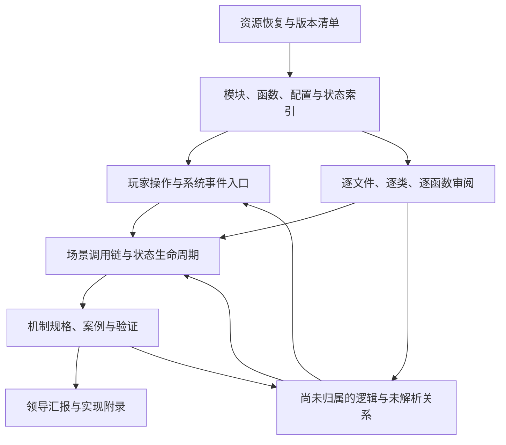

# Gossip Harbor 全量逻辑还原与汇报方案

版本：v1.0  
制定日期：2026-10-09（Asia/Shanghai）  
状态：执行方案，尚不代表各阶段已经完成。  
适用样本：当前工作区 Gossip Harbor 3.98.10；后续版本、热更新及账号配置必须分别登记。

## 1. 目标与交付标准

本项目要形成一份能够指导游戏复刻的机制规格，同时提供领导能够读懂的解释与汇报材料。

最终要求是：实现人员能够依据规格确定配置选择、执行顺序、算法、状态变化、持久化、重置和异常行为，不需要自行猜测关键规则；汇报读者能够理解玩家经历了什么、规则如何运作，以及证据和未知边界在哪里。

分析对象覆盖当前样本中发现的全部客户端代码与资源，包括核心玩法、活动、UI 交互约束、教程、生命周期、存档同步、配置装载及相关平台接口。远端资源和服务端决定的行为作为明确的外部依赖登记。

“完整”必须绑定版本与资源快照。当前客户端覆盖完整，不等于已经取得所有未来活动、所有账号分组配置或服务端实现。已确认的未知不能被隐去，也不能被猜测填满。

## 2. 已达成的方法共识

1. 先识别和恢复全部已取得资源，核验可用性，防止容器漏解。
2. 建立分类索引，识别系统、模块、配置和资源归属。
3. 从玩家操作及系统事件出发，追踪有明确上下文的运行过程。
4. 逐文件、逐类、逐函数审阅，识别每段实际逻辑，发现新机制后扩展分类。
5. 跨模块整合调用、事件、状态和配置，解释完整行为及生命周期。
6. 用证据、案例和运行观察验证，再形成汇报与实现规格。

固定检查问题只用于复核，不能限定分析范围。随机机制只是一个例子；任务范围是全部机制。

纯函数翻译不能作为分析完成的依据。代码读懂之后，还必须说明其在何种状态下被触发、造成何种结果，以及下一次执行为何可能不同。

## 3. 两条主线与闭环

### 3.1 从操作和事件向下追踪

以可理解的场景为入口，例如“点击生成器一次”“提交订单”“购买商品”“离线后重新登录”。每个场景都追踪输入条件、实际配置、分支、状态变化、后续事件与结果。

入口不仅来自玩家点击，还包括初始化、每帧或定时更新、活动切换、网络响应、应用前后台切换、存档迁移和异常恢复。

### 3.2 从代码清单向上核销

所有已识别代码单元均要有审阅记录。尚未被操作链引用的函数不能自动忽略，必须查明它属于后台入口、回调、特殊分支、工具代码、遗留代码，还是暂未找到入口的逻辑。

“未发现调用者”不足以证明代码不会执行。动态调用和事件注册未解决前，应保留为待追踪项。

### 3.3 两条主线相互验证

这张图描述工作流程，不代表已确认的游戏调用关系。

## 4. 阶段一：资源恢复与可用性审计

### 4.1 建立原始资源账本

记录 APK 与 split、Unity bundle、TextAsset、Lua 容器、配置、IL2CPP 元数据与原生库，以及已取得的远端 catalog、热更新和运行时文件。

每个资源记录来源、版本、获取时间、大小、SHA-256、父容器、处理工具与处理结果。输出文件关联回原始资源，原始证据保持不变。

### 4.2 按资源类型核验

- 容器：模块数、声明长度和实际解析长度一致；未识别内容明确登记。
- Lua：字节码版本、函数原型、嵌套函数和常量能够解析；反编译失败不等于字节码不可分析。
- 配置：字段、类型、行数和变体被保留，不能在导出时静默丢字段或将缺失值改成零。
- 原生逻辑：区分类型和签名已恢复、方法体已分析、仅找到调用入口三种情况。
- 美术与文本：能定位、关联到系统并按类型读取；不要求将所有二进制变成文本。

### 4.3 确定实际生效版本

追踪装载器及覆盖规则，说明包内代码、热更新、普通配置、活动配置和账号分组配置如何选择。文件同时存在不能证明它们同时生效。

阶段出口：每个已发现资源都有处理状态；未恢复资源及原因可枚举。存在未恢复内容时，后续可推进已恢复部分，但整体不能标记为资源完整。

## 5. 阶段二：分类与关联索引

### 5.1 分类可随发现扩展

初始分类包含棋盘与物品、生成与合成、能量与冷却、订单与奖励、经济与商店、剧情与进度、活动、教程、UI 与交互、存档与同步、装载与平台服务。

分类用于组织信息；任何无法解释的新逻辑都可以新增分类。每个文件有主要归属，也可以关联多个系统。

### 5.2 建立逻辑关联图

节点包括资源、模块、类、函数、配置、状态字段、事件和存档字段。关系至少包括：

- 直接调用、方法调用、继承、工厂或注册表选择。
- 事件注册与派发、回调传递、计时器注册及取消。
- 配置装载、覆盖、筛选及字段读取。
- 状态初始化、读取、写入、清理、重置。
- 存档写入、恢复、迁移，以及网络数据的输入和输出。

每条关系附证据位置与确定性：已确定、候选关联、未解析。动态调用不能被强行绑定到一个目标。

字段按所属对象和作用域区分。同名字段不能直接合并；对象别名导致的潜在关联保留待确认标记。

### 5.3 工具选择和验证

优先利用现有提取与解密脚本，增加可重复运行的字节码解析、索引和覆盖检查工具。可评估兼容的 Lua 5.3 反编译器，以及 Il2CppDumper、Ghidra 等工具。

采用反编译结果前，先用实际样本检查分支、循环、闭包、方法调用和多返回值是否正确。字节码和原始资源保留为证据，反编译文本只是辅助阅读材料。

运行时追踪用于确认静态分析中的歧义，包括动态调用目标、实际配置、事件顺序和状态变化。记录追踪环境与插桩方式；被观察过的路径不能代表所有路径都已覆盖。

### 5.4 内置测试框架索引

将包内 `Test.*` / `test_debug` 代码、测试窗口、命令表、快捷按钮与自定义配置作为阶段二的专门索引对象。需要建立“面板/按钮或命令 → 配置选择 → UI 回调 → TestModel 或玩法模型 → 状态/网络/存档副作用”的证据链，并登记 `ProjectConfig.IS_TEST_MODE`、本地偏好开关、账号远端自定义配置等启用条件。

每个测试入口标注静态副作用线索和证据位置；只有调用链和状态写入核实后才可标为确定。测试工具是发现和验证机制的工具，不代表正式玩家路径。运行验证优先使用隔离账号或可恢复环境；涉及删除数据、跳关、经济资源、支付、服务器配置或账号状态的命令先完成副作用审阅。

阶段二验收至少提供：测试模块全量清单；面板、标签、按钮和命令配置间的索引；可静态识别的回调和未解析目标；本地/服务端启用条件；高风险或外部副作用候选清单；运行时哪些入口实际可用的验证记录。仅发现测试代码或只列出按钮名称不算完成。

阶段出口：所有已解析代码进入索引；工具支持边界、解析失败和动态关系缺口明确列出。

## 6. 阶段三：入口场景与逐函数审阅

### 6.1 建立入口目录

| 入口类别 | 初始场景示例 |
| --- | --- |
| 棋盘操作 | 点击生成器、拖动合成、移动、出售、撤销、放入或取出仓库 |
| 资源操作 | 消耗或恢复能量、购买、领取奖励、加速冷却 |
| 订单与进度 | 提交订单、完成任务、升级、进入下一剧情阶段 |
| 活动与教程 | 活动进入或结束、领取阶段奖励、教程推进或中断 |
| 生命周期 | 首次启动、登录、重登、断线恢复、离线返回、前后台切换 |
| 自动与外部 | 计时到期、周期更新、远端配置更新、支付或广告回调 |

以上只是种子场景。审阅发现新入口时持续追加，以实际代码和资源为依据。

### 6.2 以明确状态追踪一次操作

每条链说明：进入时的玩家与棋盘状态、触发入口、条件和分支、配置选择、算法、资源扣除和产出、状态更新、事件及异步后续、保存、失败或中断结果。

同一操作在不同等级、活动、物品类型或异常状态下可能走不同链路。应共享公共段并解释变体条件，不能只记录一次成功路径。

异步分支要追到回调、取消、超时或后续入口。不能以函数返回作为整条行为完成的标志。

### 6.3 全量代码审阅

每个函数记录稳定标识、版本、文件位置或字节码偏移、所属类或原型、触发来源、行为解释、关键分支、调用关系、状态副作用、配置依赖、机制归属及未解决问题。

Lua 匿名函数、嵌套函数、闭包和动态绑定的方法均进入清单。无原始函数名时，用模块与原型路径定位，不能只靠反编译行号。

纯展示或通用辅助函数可以简述，但仍需核销；涉及交互门槛、资源、时间、状态或算法的函数必须深入说明。分支内逻辑不能被一句功能概述替代。

重复实现可引用已验证的公共解释，但需核对语义及差异。历史或疑似不可达代码登记依据，不能悄悄移出统计分母。

### 6.4 单条操作链的完成条件

- 触发入口和适用状态明确。
- 关键调用、事件与回调已追踪，未解析目标有具体记录。
- 输入、配置、分支及输出能够解释。
- 相关状态的初始化、修改、保存、恢复和重置已关联。
- 正常、边界、失败和特殊路径已说明，或明确标出证据缺口。
- 可以据此推演具体案例；关键步骤不存在未标注的猜测。

### 6.5 当前阶段三主线状态（工作基准）

第三阶段当前以“玩家操作为抓手，逐入口追踪到同步/持久化边界，并由逐文件逐函数审阅反向核销覆盖”为唯一主线。当前优先入口是棋盘中的母体点击、棋子拖拽/合成和订单提交；它们不是阶段三的全部范围，而是第一批用于建立可复刻级操作链的场景。

每条操作链必须同时交付：人类可读的顶层流程、中层判断顺序和子机制、底层算法/公式/具体配置/状态字段/事件/网络副作用，以及 source-confirmed、runtime-confirmed、runtime-pending、unavailable 证据标记。随机机制必须明确随机范围、候选池变化、是否放回、权重修正顺序和重置时机；不能只写“存在随机判定”。

在覆盖审计、场景回放、原版与复刻版逐字段差分、人工审阅四类证据未同时通过前，阶段三不得标记为完成，也不得宣称已经能够完整复刻或不存在遗漏。外观、导航和汇报页面的调整不得改变本工作文档中的目标、范围、证据分级和验收门槛。

## 7. 阶段四：跨模块整合与可实现规格

一个机制往往由多个操作链共同实现。整合时同时回答“这次怎样执行”和“整个生命周期怎样变化”。

例如，一个抽取池的建立、抽取、扣减、存档和重置可能分布于不同模块，甚至互相没有直接调用，需要通过对象、状态或事件关联起来。

### 7.1 领导阅读层

以玩家能感知的行为命名，说明触发时机、规则、结果和适用条件，配具体数字案例及必要的流程或状态图。内部名称放到证据或实现附录。

设计目的若没有直接证据，只能作为分析推断，不能当成代码事实。案例数字必须区分真实配置与演示数据。

### 7.2 实现层

提供数据结构、配置字段语义与单位、默认和缺失行为、配置选择优先级、状态归属、判断顺序、伪代码或公式、持久化与重置、异常及版本迁移规则。

随机逻辑要追到随机接口及映射方式，并区分伪随机数来源、概率分布和是否放回。可访问时继续查种子、状态及恢复；无法确认时登记边界。

两层内容引用同一机制标识和证据，避免面向领导的简化说明与实现规格出现不同结论。

## 8. Lucky 作为方法试跑

Lucky 用于检验资源恢复、动态调用解析和跨模块追踪是否有效，不能代表全部机制范围。

试跑从“在特定状态下点击一个生成器”开始，追踪普通产出与 Lucky 分支、活动模型选择、配置读取、候选建立、抽取算法、状态修改、保存及重置，发现的其他分支继续登记。

当前已知证据边界：普通生成器的 Decremental 分支存在权重扣减和归零移除；此前补提取的活动模块中包含 LuckyProduceModel。Lucky 自身是否采用不放回抽取、适用于哪个环节以及何时重置，仍须逐项验证，不能沿用普通分支的结论。

试跑应暴露工具漏检和说明不足，并修正流程；不得只完成 Lucky 后便宣称方法或全量分析通过。

## 9. 验证与验收

### 9.1 分层验收

| 层次 | 验收依据 | 不能替代验收的现象 |
| --- | --- | --- |
| 资源 | 已发现容器全部核销，解析数量及完整性核对，版本覆盖明确 | 文件已解压、已有部分模块 |
| 审阅 | 所有代码单元有审阅记录，未审阅与特殊归类可枚举 | 读过大部分核心文件 |
| 关联 | 入口、调用、事件、配置和状态关系有证据，未解析项明确 | 调用图很大、函数名很齐 |
| 解释 | 代码逻辑均有归属，行为与生命周期能够连贯说明 | 只有方法列表和逐行翻译 |
| 实现 | 依据规格可确定执行步骤与结果，关键规则不需要猜 | 只有概念、平均值或概率总览 |
| 验证 | 关键规则经案例或运行证据核对，差异已处理 | 一次观察成功、平均值接近 |

### 9.2 针对行为选择验证方式

- 确定性算法：使用明确输入核对输出与状态变化。
- 随机机制：核对池变化、抽取顺序及重置；必要时控制随机输入。频率统计只作补充。
- 时间机制：核对边界、离线、时钟来源、前后台切换和活动结束。
- 事件机制：核对注册、派发顺序、重复触发、取消与解绑。
- 存档机制：核对保存后重登或恢复，判断状态是否延续。
- 配置机制：核对真实生效变体及缺字段行为。

优先选择能区分竞争解释的案例，例如固定概率独立抽样与有限池不放回抽样。不能只挑各类模型都可能通过的普通案例。

### 9.3 完整性复核

定期自动输出未审阅函数、未归属逻辑、未解析调用、未解释状态写入、缺失配置、未追踪事件和未闭合生命周期列表。

覆盖指标分别报告资源、文件、类、函数、机制和验证状态，并保留分母、统计版本及排除依据。清单增加后重新计算，不把文件覆盖率等同于逻辑完整度。

新发现的调用、状态或配置可能使已完成机制重新打开，必须更新状态与影响范围。

## 10. 证据与问题管理

结论区分配置确认、代码确认、运行观察、分析推断和无法确认。这些是不同证据类型，不能用一种证据替代另一种。

每个问题记录所在版本、机制、具体未知、已有证据、缺少的材料、受影响结论与实现、下一步取证办法及解决状态。

以下表述必须严格区分：

- 当前包内未发现。
- 已取得但尚未解密或解析。
- 已恢复但尚未分析。
- 已分析但动态关系尚未确定。
- 外部接口可见，但服务端内部实现未知。

发现旧报告或模拟使用了未经证实的假设时，记录受影响产物和修订任务。新证据不能只停留在审阅笔记中。

## 11. 工作产物与目录

沿用 ANALYSIS_SPEC.md 的原始证据、中间数据、工具和交付结果分层。下列路径为计划产物，不代表已经生成。

| 计划位置 | 内容 |
| --- | --- |
| analysis_data/logic_index/ | 资源、模块、函数、关联、入口及版本索引 |
| tools/ | 可重复运行的解析、索引、覆盖检查及报告构建工具 |
| analysis_output/logic_recovery/reviews/ | 逐文件、逐函数审阅记录与问题 |
| analysis_output/logic_recovery/scenarios/ | 玩家操作和系统事件的场景链 |
| analysis_output/logic_recovery/mechanics/ | 整合后的机制规格与实现附录 |
| analysis_output/logic_recovery/validation/ | 验证案例、环境、观察和差异 |
| analysis_output/logic_recovery/ | 汇报、覆盖情况、证据索引与遗留清单 |

正式分析交付按现有规范生成可复查的结构化数据和独立 HTML；本文件是工作方案，不代表已经产出分析结果。审阅记录与索引之间使用稳定标识关联。

## 12. 前两天的执行安排

两天作为第一轮执行周期。以取得的代码规模、解析难度和实际审阅速度调整后续估时，不降低全量覆盖要求。

| 时间段 | 工作重点 | 阶段产物 |
| --- | --- | --- |
| 第一天上午 | 清点资源，补恢复与完整性核验，确认版本关系 | 资源账本、缺口与代码规模 |
| 第一天下午 | 建立初始分类和关联索引，以生成器及 Lucky 试跑 | 索引工具初版、首条操作链、首份机制规格 |
| 第二天上午 | 修正工具与流程，持续逐函数审阅并拓展操作链 | 审阅记录、跨模块关联与新增机制 |
| 第二天下午 | 复核覆盖，验证已还原规则，整理阶段汇报 | 已确认规格、覆盖情况、问题与后续安排 |

启动阶段不能跳过资源审计。进入代码审阅后，每个工作批次同时更新代码审阅状态、场景链、机制归属和问题列表，防止全部阅读结束后才发现无法整合。

## 13. 最终完成判定

在声明某版本的客户端逻辑还原完成前，必须满足：

1. 已发现资源的处理情况完整公开，影响逻辑的未恢复内容已解决。
2. 全部已识别代码单元完成审阅，特殊归类有依据。
3. 玩家操作和系统入口均有归属，尚未找到入口的逻辑逐项处理。
4. 调用、事件、配置和状态的关键关系已闭合；影响实现的歧义已解决。
5. 每个机制均有可读解释、实现规格及证据，关键行为经过验证。
6. 旧报告、公式与模拟中受新结论影响的内容已经修订或明确撤回。
7. 外部依赖与未能还原的服务端行为明确列出，完成声明的范围与它们一致。

项目不承诺“任何人知道的设计点都已知道”。项目承诺用全量资源核销、逐函数审阅、场景追踪、状态生命周期和验证形成可检查的覆盖证明，并把尚未知晓的部分明确暴露出来。
